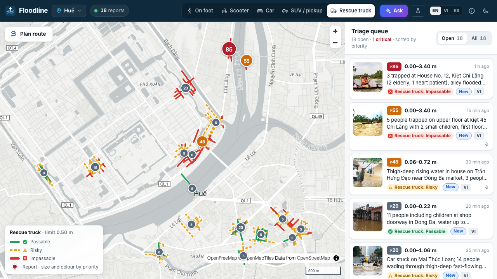
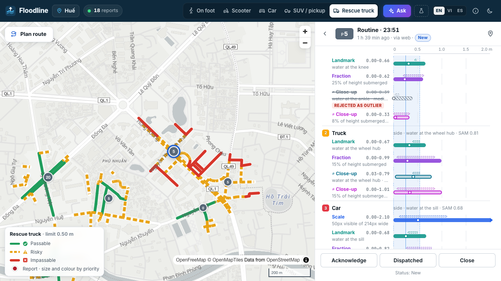
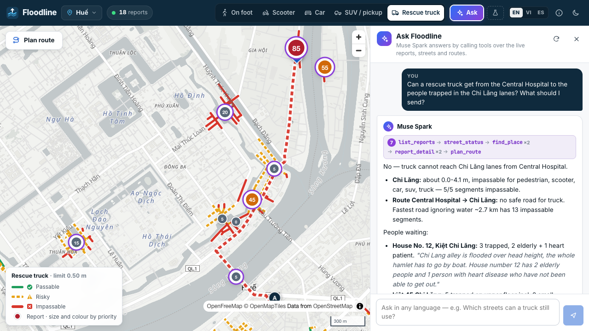
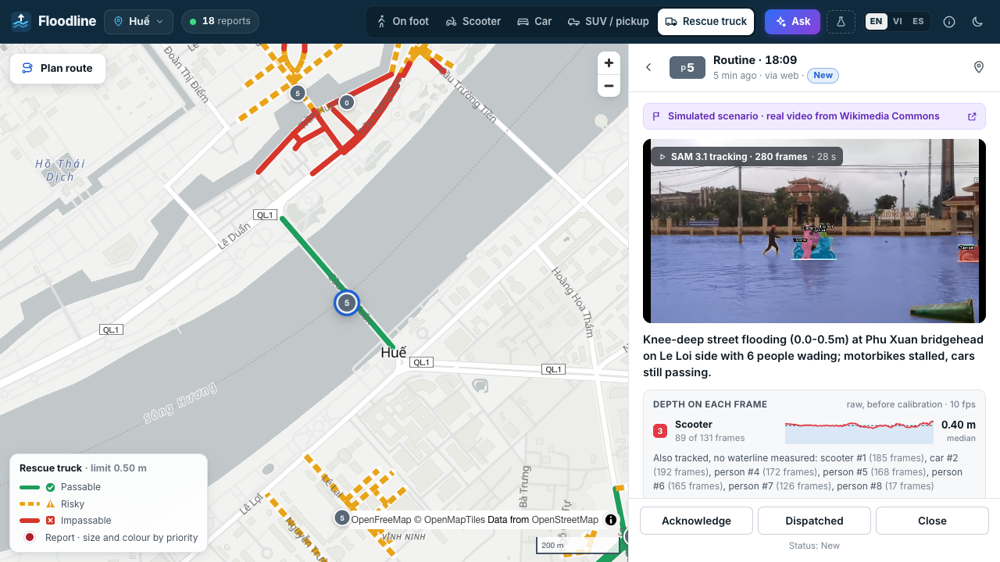

# Floodline

[](https://github.com/ZNLong2203/Floodline/actions/workflows/ci.yml)
[](LICENSE)

**Every street, measured from the photos people already send.**

When a city floods, residents send photos, clips and voice calls for help by the thousand, in their
own language. Rescue coordinators read them one by one, and still can't answer the question that
decides who gets reached tonight: *which streets can a scooter, a car or a rescue truck still get
through?*

Floodline reads each photo, clip or voice note with Meta's models, measures the water against things
of known size in the frame (a scooter's seat, a person's knee, a car's wheel), and turns the reports
into a live street map of what each vehicle can cross, routes that avoid the water, and a rescue
queue ordered by a published formula.



> Built for the Meta Global AI Developer Hackathon (Indie track, theme *Build for Your World*), first
> for Huế, Vietnam, where the floods come every autumn, and shown on Valencia, Spain (October 2024).
> Runs on **Muse Spark 1.3**, **SAM 3.1** and **Muse Voice Transcribe** through the Meta Model API.

## The problem

- Central Vietnam floods every October–November. In 2025, 32 of Huế's 40 communes were under 1–2 m of
  water, 133,000 homes flooded and 35 people died ([Malay Mail](https://malaymail.com/news/world/2025/11/02/death-toll-from-vietnam-floods-climbs-to-35-amid-worst-rains-in-decades/196904)).
  In October 2026 Huế took more than 800 mm of rain in three days ([The Star](https://www.thestar.com.my/aseanplus/aseanplus-news/2026/10/20/vietnam-mobilises-troops-after-heavy-rains-trigger-flash-floods-and-raise-risks-of-landslides)).
- Help requests already arrive as photos and voice messages: about 10,000 SOS requests went through
  Zalo community groups in the 2020 floods ([Znews](https://znews.vn/nhung-dem-thuc-trang-va-hon-10000-loi-keu-cuu-tren-zalo-post1149198.html)).
  None of them carries a depth, and a coordinator can't tell from a pin on a map whether the truck
  will reach it.
- It isn't a Vietnamese problem. On 29 October 2024 a DANA storm dropped nearly 500 mm in eight hours
  on Chiva, the Poyo ravine overflowed through the towns south of Valencia, and 232 people died, most
  within hours of the water arriving ([NASA](https://science.nasa.gov/earth/earth-observatory/valencia-floods-153533)).

## What Floodline does

1. **Reads a photo, a clip or a voice note** sent from a phone (`/report`, in the resident's language).
2. **Measures the depth with an honest interval**, showing every reading it used and rejected.
3. **Decides per vehicle**: passable, risky or impassable, by the probability of exceeding that
   vehicle's limit, with limits taken from published flood-safety guidance.
4. **Maps streets, not pins**: reports become depths on OpenStreetMap street segments, widened by
   distance and age, and each vehicle is routed around the water.
5. **Orders the rescue queue** by a fixed formula over facts Spark extracts from the resident's words,
   shown in the original and translated, with a dispatch draft in both languages.
6. **Answers questions**: *Ask Floodline* is a Muse Spark agent with tools over the live map. Ask
   "Can a truck from the hospital reach the people in the Chi Lăng lanes?" in English, Vietnamese or
   Spanish; it checks reports, streets and routes, shows every step, and draws the route.
7. **Works for any city**: a city is an OpenStreetMap extract, its residents' language and its
   people's heights ([data/cities/](data/cities/)). Huế and Valencia ship with the demo.

## How it uses Meta's models

| | What it does in Floodline |
|---|---|
| **Muse Spark 1.3**: perception grounding | Finds reference objects and boxes them on its 0–1000 grid, says which way each faces and which part of it the water reaches, flags blurred or edited photos. JSON Schema-constrained. |
| **SAM 3.1**: concept prompt | `flood water` → the water mask, in parallel with Spark. |
| **SAM 3.1**: box prompts from Spark | Spark's boxes become SAM prompts, so every object Spark named gets a pixel-exact mask under a known id. The waterline is measured where the two masks meet. |
| **Muse Spark**: close-up second look | Every object standing in water is cropped, enlarged and re-examined in one multi-image call. Adding it cut the raw error by 11% (0.257 → 0.229 m). |
| **SAM 3.1**: video tracking | In a walk-by clip, each object is tracked through hundreds of frames from one box prompt, and measured on every frame. |
| **Muse Spark**: video understanding | Watches the whole clip with its sound: its own depth range, what happens, anything said. |
| **Muse Voice Transcribe** | Voice notes in the city's language (25 supported), for people who can't type with wet hands in the dark. |
| **Muse Spark**: fact extraction and translation | People, vulnerability, injury, rising water, needs; the resident's message in English; summary and dispatch draft in English and in their language. |
| **Muse Spark**: tool use | *Ask Floodline*: five tools (reports, street status, places, routing, report detail) over the live state, answering in the language of the question. |

The models name, point, outline and listen. **Plain code does the arithmetic**: waterline rows,
pixels to metres, outlier rejection, probabilities. Every number can be traced to an object on the
overlay and every size to a source. More in [docs/architecture.md](docs/architecture.md) and
[docs/estimation.md](docs/estimation.md).





## Does it work?

Tested on 292 flood photos with human depth labels (FloodDET, CC BY 4.0). Every calibrated number
is **out of fold**: 5-fold cross-validation, grouped by photo.

| | depth error (MAE) | true depth inside the interval |
|---|---|---|
| Muse Spark answering alone | 0.277 m | 52% |
| Floodline, raw | 0.229 m | 67% |
| Muse Spark alone, calibrated | 0.220 m | 93% |
| **Floodline, calibrated** | **0.199 m** | **95%** |

For a car (limit 0.30 m), Floodline was right 94% of the time when it decided, sent 61 of 257
photos to a human as "risky", and called **2** passable that were over the limit. The full tables,
per reading, per class and per vehicle, and the caveats (the photos aren't Vietnamese, and the labels
are judgements on a person-height scale) are in [docs/evaluation.md](docs/evaluation.md).

## Try it

Everything runs without an API key: every model answer behind the demo and the evaluation is recorded
in `data/cassettes/`.

```bash
uv sync
(cd web && npm install && npm run build)
FLOODLINE_MODEL_MODE=replay uv run floodline seed --city hue        # a simulated flood night in Huế
FLOODLINE_MODEL_MODE=replay uv run floodline seed --city valencia   # and in Valencia, October 2024
FLOODLINE_MODEL_MODE=replay uv run floodline serve                  # http://127.0.0.1:8000
```

Open the console at `/`, choose **Xe tải cứu hộ** (rescue truck), and plan the route
*BV Trung ương Huế → Thành nội*: the shortest way crosses four segments a truck can't, so the route
goes round. *→ Chợ Đông Ba* has no safe road left. Click the red Chi Lăng report for the evidence,
open **Ask** and try an example question, or switch the city to Valencia.

With a key from [dev.meta.ai](https://dev.meta.ai) in `.env` (`MODEL_API_KEY=…`), new photos are
analysed live:

```bash
uv run floodline analyse photo.jpg          # depth, verdicts and an overlay in var/analyses/
uv run floodline serve                      # then send a photo from /report on your phone
```



## Honest limits

- **A photo is a coarse instrument.** The calibrated interval is about ±0.4 m. That is enough to
  say "no scooter" or "a truck can pass", and not enough to say 37 cm. Floodline says "risky" and
  leaves the decision to a person when it can't tell.
- **The evaluation photos are not Vietnamese**, and no labelled set of Vietnamese flood photos exists
  that we could find. The reference sizes are Vietnamese: Honda and Yamaha Vietnam scooters,
  Vietnamese cars, Vietnamese adult heights.
- **The scenarios are simulated.** The photos are real floods (Wikimedia Commons). Huế's were taken
  elsewhere in Vietnam; Valencia's are from the October 2024 floods, six placed at the camera's own
  GPS. Places, times and messages were written for the demo, and the console says so on every
  scenario report.
- **Depth from one photo is published work** (e.g. FloodVision, 2025, ~9 cm on curated images; DeepFlood,
  2020). Floodline's contribution is the pipeline around it: calibrated intervals, decisions per
  vehicle, street fusion and routing, triage, and the channels residents already use.

## Repository

```
floodline/      pipeline, models, geometry, calibration, fusion, routing, triage, API
evals/          evaluation harness and cross-validated calibration
data/           catalog of sizes and limits (sourced), calibration, cities (Huế, Valencia),
                their streets (OSM), demo photos and clips (Wikimedia Commons), scenarios,
                recorded model answers
web/            coordinator console and resident page (React, MapLibre)
docs/           architecture, estimation, evaluation, triage
```

## Credits

- Demo photos and clips: Wikimedia Commons contributors, see [data/demo/ATTRIBUTION.md](data/demo/ATTRIBUTION.md)
  and [data/demo/valencia/ATTRIBUTION.md](data/demo/valencia/ATTRIBUTION.md).
- Streets: © OpenStreetMap contributors (ODbL). Basemap: OpenFreeMap.
- Heights: Vietnamese and Spanish adults from national surveys and NCD-RisC (sources in the catalog and
  [data/cities/](data/cities/)).
- Evaluation data: FloodDET, G. Singha (CC BY 4.0), with DeepFlood's level table (Chaudhary et al. 2020).
- Sizes and limits: sources listed in [data/references.yaml](data/references.yaml) and [data/thresholds.yaml](data/thresholds.yaml).

MIT licence.
